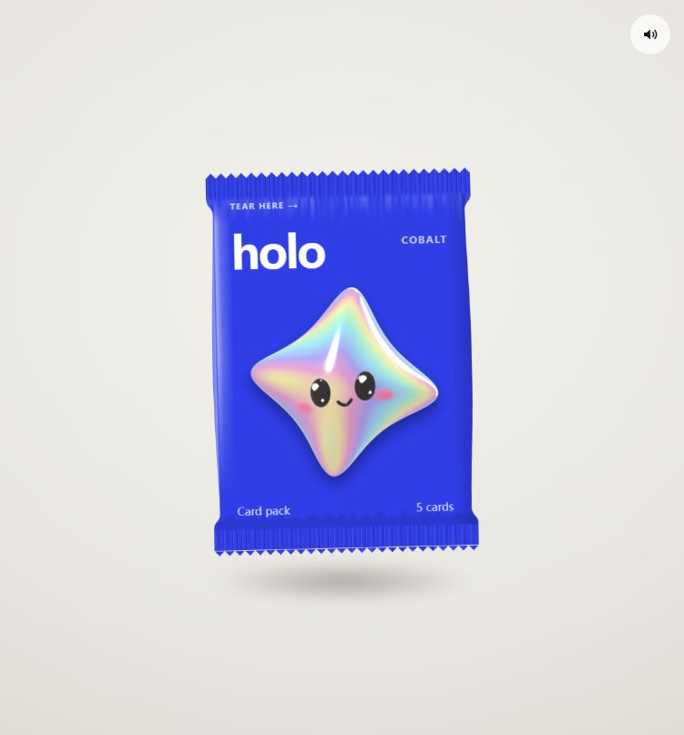
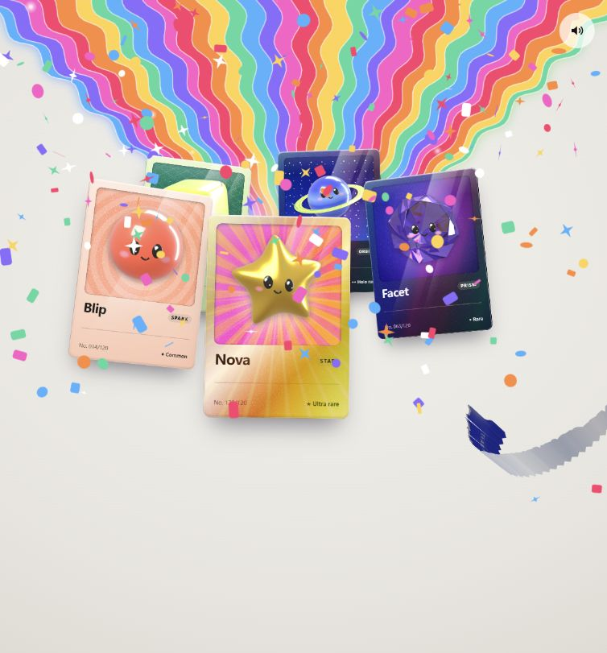
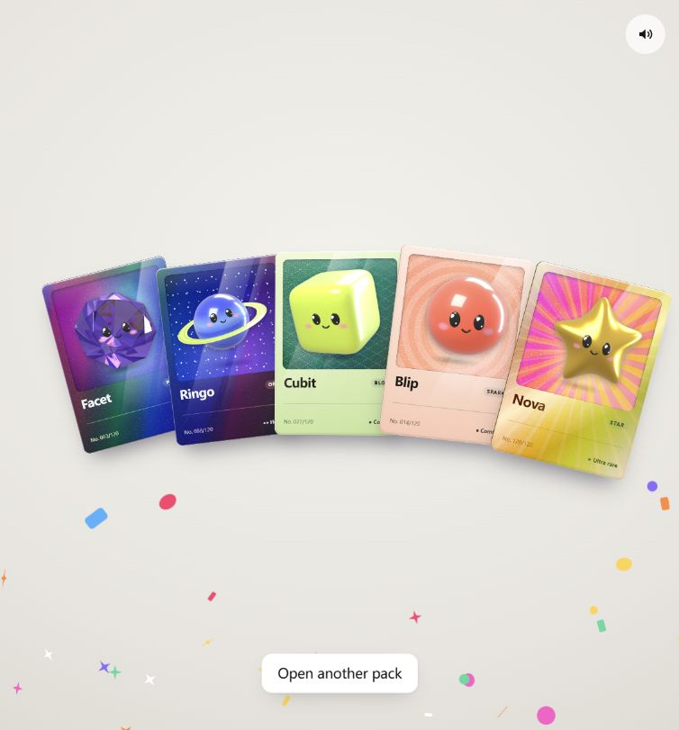

并非一作
# holo 源码恢复

来源：https://holo.yashb.xyz/

恢复自原站公开返回的 HTML。原始响应保存在 `reference/original.html`；页面、样式、交互逻辑和角色素材均已提取。`src/app.js` 和 `src/styles.css` 与原始响应逐字一致，31 张 WebP 素材和全部角色定位数据经过无损往返校验。运行副本移除了 Cloudflare 统计脚本。

## 页面截图

本地恢复版本的实际浏览器截图。

| 未开封卡包 | 拆包动画 | 卡片展开 |
| --- | --- | --- |
|  |  |  |

## 直接打开

用现代浏览器打开 `dist/index.html`，无需联网或安装依赖。

## 本地开发

安装 Node.js 20 或以上版本，在本目录运行：

```powershell
npm start
```

按终端显示的地址访问，默认是 http://127.0.0.1:4173/ 。端口被占用时会自动尝试下一个端口。按 Ctrl+C 停止。

```powershell
npm run build    # 把当前源码重新打包成独立的 dist/index.html
npm run check    # 校验快照、脚本语法、素材和独立 HTML 的一致性
npm run recover  # 从保存的原始快照重新提取；会覆盖 index.html、src/ 和对应素材
```

无需运行 `npm install`，本工程没有第三方依赖。

## 文件

| 文件 | 内容 |
| --- | --- |
| `reference/original.html` | 原站完整响应，包含 CSS、JS、Base64 素材和原始统计标签 |
| `reference/capture.json` | 来源地址、快照 SHA-256 和提取信息 |
| `index.html` | 拆分后的页面结构 |
| `src/styles.css` | 原站全部 CSS |
| `src/app.js` | 原站全部交互、物理模拟、彩带、粒子和声音代码 |
| `src/art.js` | 六个角色的图片路径及表情定位数据 |
| `assets/characters/` | 31 张透明 WebP 图片 |
| `dist/index.html` | 可独立打开的离线单文件版本 |
| `scripts/` | 提取、打包、校验和本地服务器脚本 |
| `screenshots/` | 本地页面的实际运行截图 |

## 实现要点

- 无前端框架、Three.js 或 WebGL；使用 CSS 3D、SVG、Canvas 2D 和 Web Audio API。
- 角色图片旁的原始注释说明其在 Blender 中建模、路径追踪渲染；公开页面只包含成品图片，不包含 Blender 工程。
- `Spring` 类驱动包装倾斜、回弹、撕裂和卡片运动。主循环对物理模拟作子步进以保持稳定。
- 包装沿 96 段不规则路径撕开；撕条在桌面端由 12 片组成，触屏设备为 8 片。
- 五张卡固定为 Blip、Cubit、Facet、Ringo、Nova。每包打乱顺序，六种包装配色不会连续重复，并重新生成撕裂与高光形状。
- 全息效果由随倾斜变化的渐变、混合模式、噪点遮罩和反光层叠加完成。
- 声音由浏览器实时合成；静音偏好记录在本地 `localStorage`。
- 支持点击开包、拖动撕开、悬停卡片、键盘访问和减少动态效果设置。

## 验证范围

源码、图片、角色坐标、HTML 结构和独立构建的一致性校验及 JavaScript 语法检查均已通过。本地浏览器已验证拖动撕包及五张卡片展开，页面控制台未报告警告或错误。

原始页面未声明源码或素材许可证；原站代码及美术的权利归各自权利人。本目录的整理不为原始内容另行授予许可。
